# CookAppoint
代厨预约上门系统
角色：用户、厨师、管理员；
亮点：AI问答、 协同过滤厨师推荐、WebSocket实时沟通、 ECharts数据看板、排班与预约联动；

# 代厨预约上门系统

> Vue 3 前台 + Spring Boot 3 服务端，用户、厨师、管理员三端分开作业：用户挑厨师、点菜、约会话时间，厨师维护排班和菜品、接单推进服务，管理员管账号、处理拒单退款和意见反馈。AI 问答、协同过滤推荐、WebSocket 沟通三条线各有明确落点。

做这套系统起因挺实在——家里老人行动不便，想找个厨师上门做顿饭，结果在几个本地群里问了三天才凑上，价格、时间、能不能做清淡口味全靠微信一句一句问。聊下来发现，这类上门代厨最缺的不是厨师，而是把**档期、菜品清单、沟通记录**摆在一起的地方。所以这套系统重点做了两件事：把厨师排班和预约绑死，让用户下单前能先问清楚。AI 问答和协同过滤推荐是顺着这个需求补的，恰好解决了「不知道选谁」这一步。

## 技术栈

| 层次 | 技术选型 |
| --- | --- |
| 架构 | B/S、MVC、前后端分离、用户端 + 厨师端 + 管理后台、多角色业务管理 |
| 服务端 | Java 17、Spring Boot 3、Spring MVC、MyBatis-Plus、MySQL、JWT、WebSocket、SSE、OkHttp、Apache POI、DeepSeek API |
| 前端 | Vue 3、Vite、Element Plus、Vue Router、Pinia、Axios、ECharts、AiEditor |
| 开发工具 | IDEA、JDK 17、Maven、Node.js、MySQL |

## 功能亮点

**1. AI 问答（流式回复）**
把平台菜系和厨师信息作为上下文，回答用餐建议、厨师推荐和预约问题。支持多轮对话、流式输出、历史会话保存，回答里可以带厨师编号，前端据此渲染成能点的卡片，点进去直接是厨师详情页。用户从「问一句」到「约一单」，中间不用来回跳。

**2. 协同过滤厨师推荐**
拿用户对厨师的评价评分算余弦相似度，找出偏好相近的用户，把他们认可、而当前用户还没评价过的厨师推上来。冷启动分两层兜底：评价数据不够时参考预约记录，连预约都没有就退回高评分厨师，新用户和老用户都能拿到结果。

**3. WebSocket 实时沟通**
用户和厨师在预约前就能聊口味、食材和上门细节。配合订单状态变更提醒、咨询回复提醒和未读消息红点，进度不用靠打电话追。用户端聊天框支持 Ctrl+Enter 发送，厨师端是独立的消息窗。

**4. ECharts 数据看板**
平台和厨师两套视图分开看。厨师这边是近 7 天预约量折线、订单状态分布环形、近 6 个月收入柱状、评分分布横向柱；管理员那边看订单趋势、状态分布、菜系菜品数量和用户增长，合计 8 张图表，各自只看自己该看的那部分。

**5. 排班与预约联动**
厨师维护每周排班和可预约时段，用户按日程挑时间上门。时段一旦被预约占用，厨师端就不能随手删改；订单取消会释放时段；下新单时会检测时间冲突，避免同一时间段被重复占用。

**6. 三端上门服务全流程**
用户选厨师、选菜品、预约时段、完成模拟支付；厨师接单后按「已接单 → 服务中 → 已完成」推进；服务结束由用户评价；管理员处理入驻审核、拒单审核和退款。订单状态在用户端分成十个页签，每一步都能对上。

## 系统角色与界面

### 登录入口

一个入口，登录时在下拉里选角色（用户 / 厨师 / 管理员），账号密码登录，配注册和忘记密码。演示账号是 zhangsan。

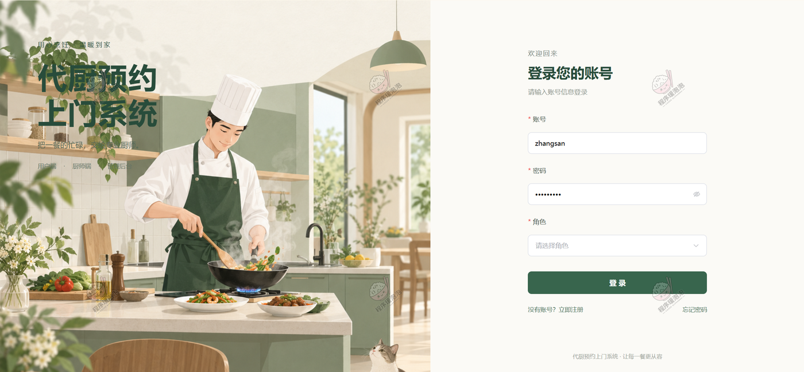

### 一、用户端（Web 前台）

**首页**
顶部导航四项：发现厨师、厨师列表、我的预约、AI 助手，右侧消息铃铛带红点（未读提醒）和个人中心。首屏是大图配一句「好好吃饭，从一位好厨师开始」，中间一个搜索框可直接搜厨师、菜系、菜品名，下面一行小字提示可以「发现合适厨师」或「还想聊？问问 AI 助手」。往下三步说明流程：01 找到合口味好厨师、02 安排时间厨师上门、03 在家安心吃一餐。

「把手艺，请到家里」是厨师卡片区，可按菜系筛，每张卡带评分角标、接单年限、擅长菜系标签和服务区域，右下角进详情。「今天，想吃点什么？」是菜品横向卡，回锅肉 ¥68、白切鸡 ¥88、剁椒鱼头 ¥98、清蒸石斑鱼 ¥168。底部左侧是 AI 助手的引导卡（问它缺什么食材、提前多久预约都可以），右侧是服务公告，平台公告、代服务规范更新、春节客服时间调整分条列出。

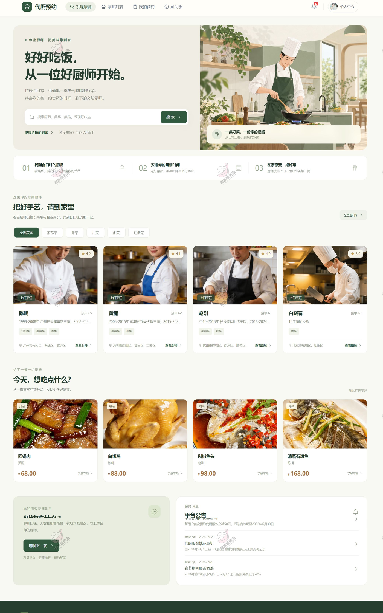

**厨师列表**
筛选条件四个：厨师姓名、所在城市、菜系、评分下限，右侧「查找厨师」和「重置」。页面写「找到 4 位厨师」，右上角排序下拉。四张卡摆出来：陈明 4.2、接单 65 次；黄丽 4.1、62 次；赵刚 4.0、61 次；白晓春 3.9、60 次。服务区域细到区一级——广州市天河区、海珠区、越秀；深圳市南山区、福田区、宝安；佛山市禅城区、南海区、顺德；北京市东城区、朝阳区。

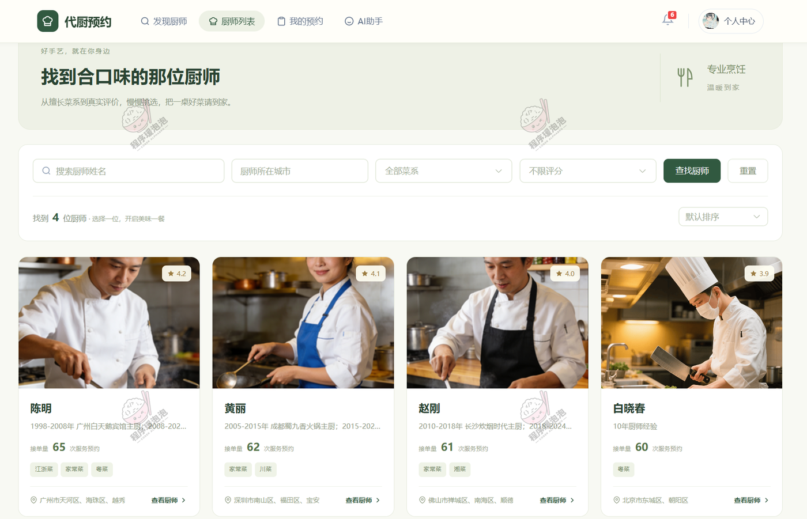

**厨师详情**
头部三个数字并排：评分 4.2、接单 65+、好评率 76%。简介写「20 年粤菜烹饪经验，擅长粤式茶楼点心、经典粤菜制作，可上门制作家宴、寿宴、商务宴请」。右上两个按钮「咨询」和「查看菜品」，往下的五页签是厨师简介、工作经历、资质证书、排班日程、用户评价。

默认落在排班日程：周视图从 2026-10-05 到 10-11，每天一列，时段卡分两种颜色——浅绿的「可预约」、浅红的「已预约」。周一 17:00–19:00 和 11:00–13:00 都已被约走，周二、周三还有空档，「今天」按钮可以跳回本周。

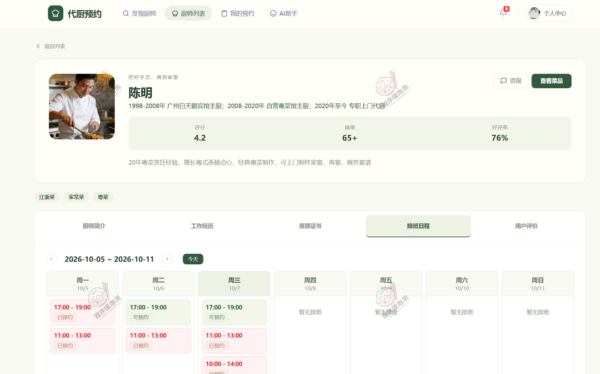

**咨询厨师**
左侧会话列表三个厨师（白晓春、陈明、黄丽），带最后一条消息的预览和时间；右侧是对话窗，顶部写「在线咨询」，右边「查看厨师主页」。消息气泡带发送者和时间戳，输入框提示 Ctrl+Enter 发送，右下角发送按钮。

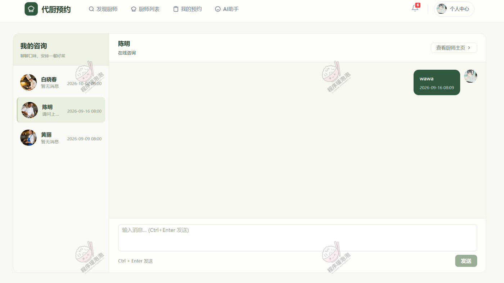

**厨师拿手菜**
从详情页「查看菜品」进来的页面，标题是「陈明的拿手菜」，顶部带厨师头像、评分 4.2、接单 65，右上角「预约下单」。菜系筛选六个：全部、家常菜、粤菜、川菜、湘菜、江浙菜。四道菜带图：白切鸡 ¥88、清蒸石斑鱼 ¥168、叉烧包（6 个）¥38、清炖狮子头 ¥134。

> 源文档把这一页标成「菜品管理」，但画面上是用户在看厨师会做什么菜，没有增删改按钮，所以按实际内容写。

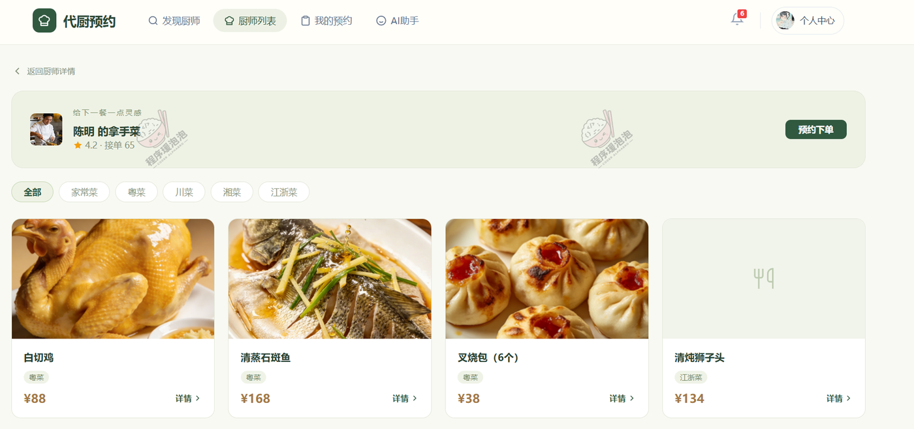

**预约下单**
四步进度条：① 选择菜品 → ② 选择时间 → ③ 填写信息 → ④ 确认订单。菜品区标题「从 陈明 的菜品中选择」，每道菜带 − / 数量 / + 控件，白切鸡 ¥88、清蒸石斑鱼 ¥168、叉烧包（6 个）¥38、清炖狮子头 ¥134、番茄炒蛋 ¥146。底部实时算账「已选 1 道菜，合计：¥38.00」，右下角「下一步」。

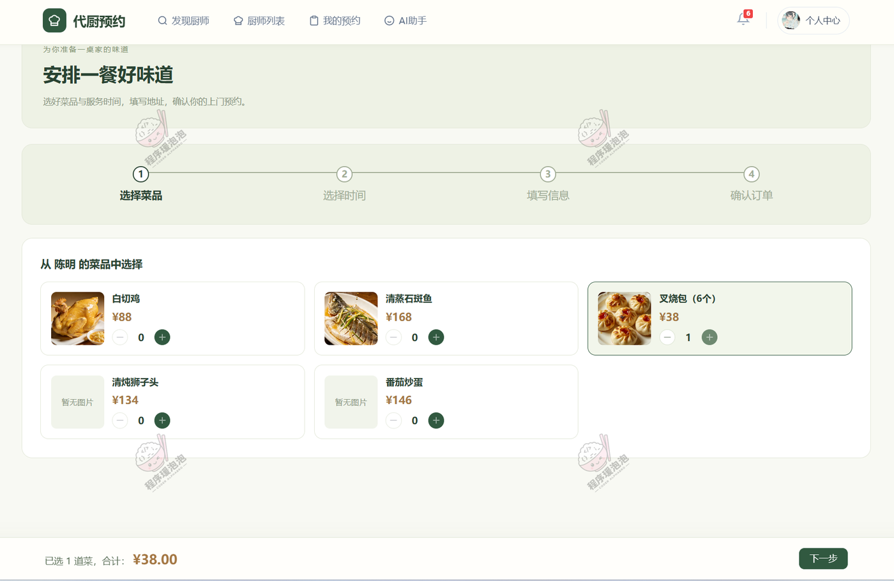

**我的预约**
左侧个人中心六项：个人资料、我的预约、修改密码、我的评价、意见反馈、地址管理。上方用户卡写「张先生 / 普通用户」，手机和邮箱打码，右边「发现更多厨师」。标题区右上角有「导出订单」。

状态页签一共十个：全部预约、待支付、待接单、已接单、服务中、已完成、已取消、已拒单、退款中、已退款。订单卡给出编号（BO1791360838902）、下单时间、状态标签、厨师、服务日期 2026-10-07 17:00—19:00、用餐人数 2 人、订单金额 ¥38.00，底部「查看详情」和「申请退款」。

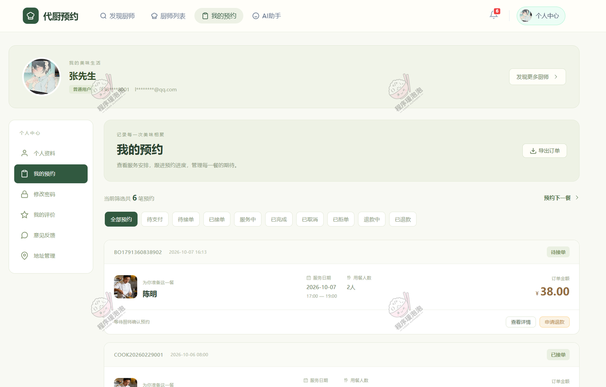

**AI 问答**
左边是会话列表，「+ 新对话」可以开新会话；右边标题「AI 小厨助手」，右上角标注两个能力：菜品建议、厨师推荐。问「推荐一位评分最高的厨师」，回答分点给出厨师名、综合评分、擅长菜系和服务特点，末尾跟一行 `[推荐厨师:chef_zhang001]`——这行是结构化标记，前端拿它渲染成可点击的厨师卡片，点进去就是详情页。输入框 Enter 发送、Shift+Enter 换行。

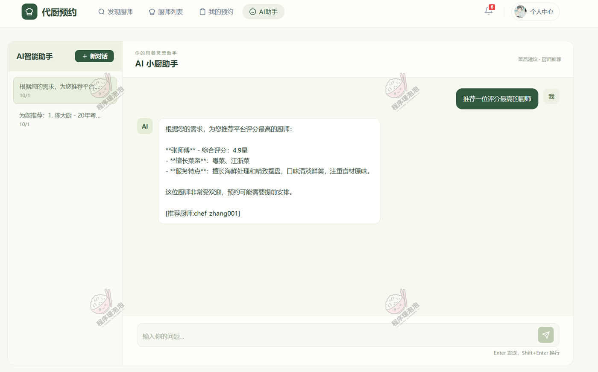

### 二、厨师端（厨师工作台）

厨师登录后进的是独立的「厨师工作台」，左侧五组菜单：概览（服务统计）、个人管理（厨师信息）、菜品服务（菜品管理、厨师日程、订单管理）、互动反馈（评价管理、咨询回复、意见反馈）。

**服务统计**
四张 ECharts 排成两行：近 7 天预约订单量折线（10-01 到 10-07，10-06 是个明显峰值）、订单状态分布环形（已退款、已拒单、已完成、已接单、待接单、退款中、已支付、已取消，八个状态都在图例里）、近 6 个月收入统计柱状、评分分布横向柱（5 分最长，3 分最短）。

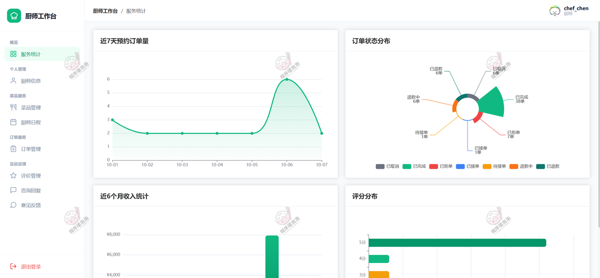

**菜品管理**
按关键词、菜系类型、是否上架筛选，右上角「+ 添加菜品」。表格列：菜品名称、菜系类型、价格、菜品图片、是否上架、操作。5 条正好是那五道菜，价格和用户端一字不差，操作给「修改 / 删除」，全部上架。

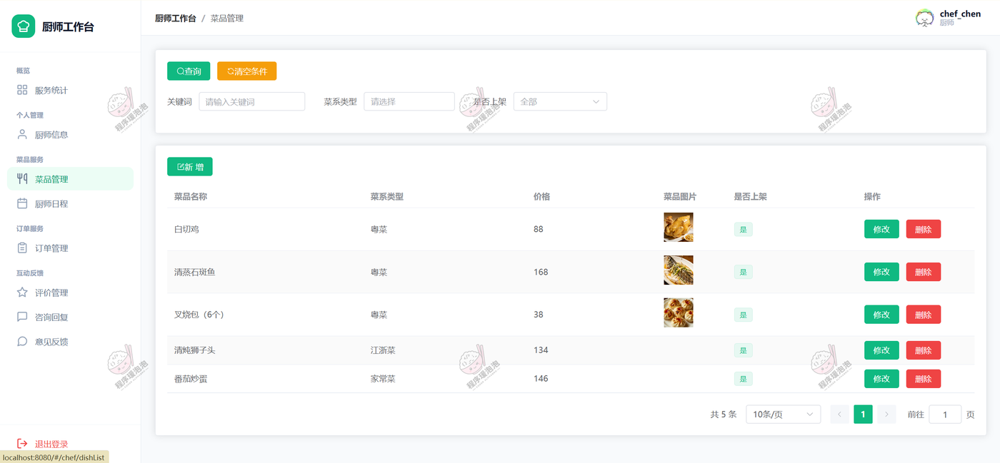

**厨师日程**
周视图，和用户在详情页看到的排班是同一份，区别是这里能改。每天底部有「+ 添加时段」，时段卡分两种：**可预约的带「编辑 / 删除」，已预约的不带**——被订单占住的时段不能随手删掉，这是排班和预约绑在一起的直接体现。

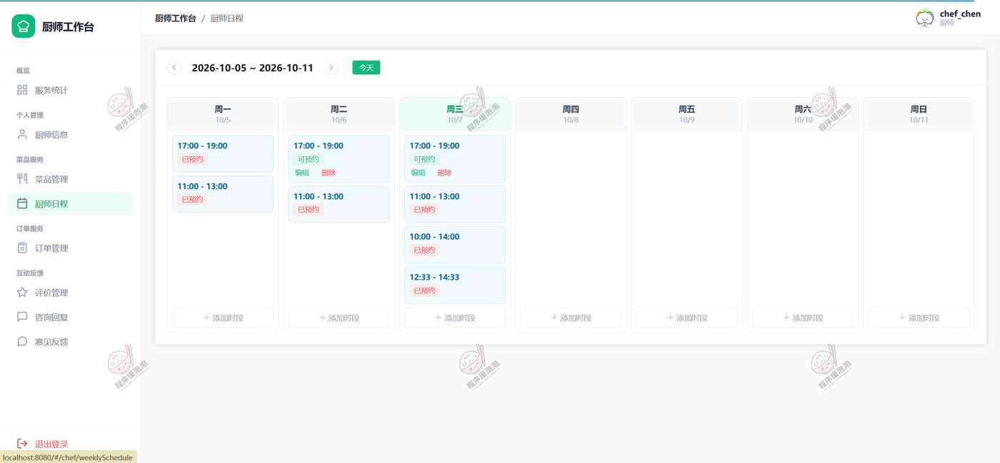

**订单管理**
按订单编号和状态查。表格列：订单编号、用户、服务地址、联系电话（中间四位打码）、服务日期、用餐人数、订单总额、订单状态、操作。操作按钮跟着状态走：待接单给「接单 / 拒单」，已接单给「开始服务」，已拒单给「退款」，已完成和已取消只留「详情」。

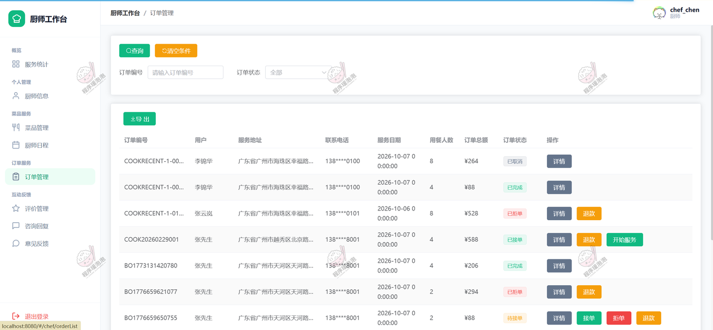

**评价管理**
按用户筛选，每条列出用户、订单编号、评分、评价内容、评价图片、我的回复，内容和图片都点「查看详情」展开。9 条评价从 1 分到 5 分都有，正好是服务统计里那张评分分布图的数据来源。右侧「修改回复」可以补回复或改回复。

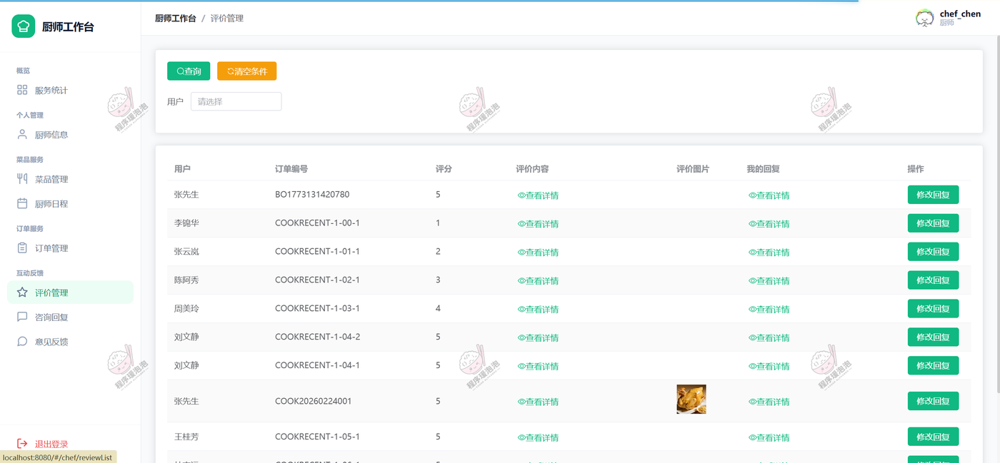

**咨询回复**
左侧咨询列表，未读的那条标红字「未读」，预览里能直接看到用户问的是「请问上门服务需要准备什么厨具？」。右侧是对话窗，底部输入框加「发送」按钮。

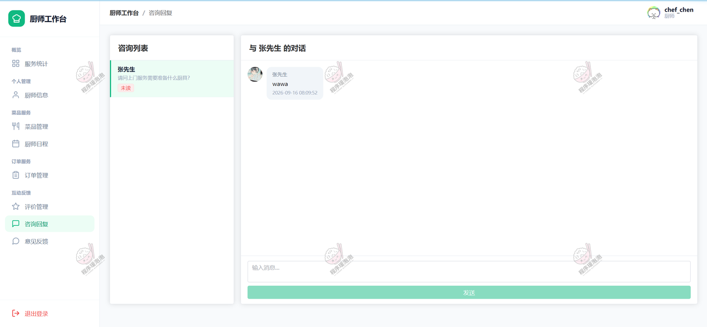

### 三、管理员端（平台控制台）

管理员进的是「代厨预约系统」控制台，左侧五组菜单：概览（控制台）、用户管理（客户管理、管理员管理）、厨师管理（厨师列表、厨师日程）、菜品与订单（菜系类型、菜品管理、预约订单）、互动与反馈（评价管理、意见反馈、公告管理）。

**厨师日程**
和厨师端那张不是同一个视图。这里是跨厨师的列表，筛选条件多了厨师、预约状态、日期范围、开始时间和结束时间范围，表格列是厨师名称、日期、开始时间、结束时间、预约状态，能一次看到陈明、白晓春、黄丽、赵刚四位在 2026-10-07 的时段。操作只有「删除」和「批量删除」。

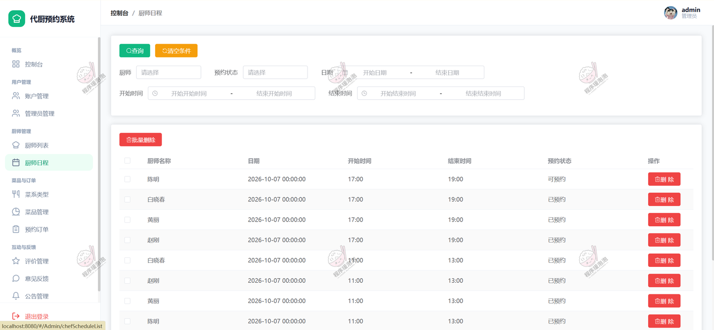

**菜品**
跨厨师视图，比厨师端多三列：厨师名称、烹饪说明、食材用料（后两个点「查看详情」展开）。筛选条件也多了一个厨师维度。回锅肉 68（黄丽 / 川菜）、白切鸡 88（陈明 / 粤菜）、剁椒鱼头 98（赵刚 / 湘菜）、清蒸石斑鱼 168（陈明 / 粤菜）、辣椒炒肉 58（赵刚 / 湘菜）、叉烧包（6 个）38（陈明 / 粤菜）。

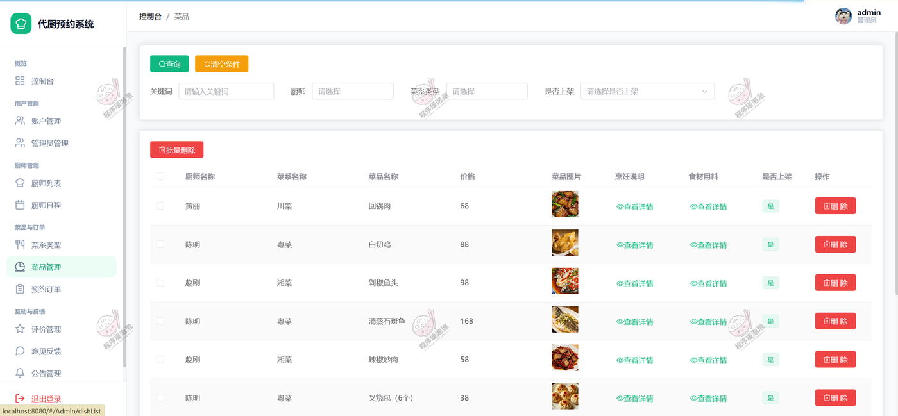

**预约订单**
全局视图，能看到所有用户对所有厨师的单。表格列：订单编号、用户、厨师、服务日期、用餐人数、订单总额、订单状态、操作。状态覆盖已取消、已接单、服务中、待接单、已完成五种，能看到同一用户在不同厨师那里的多笔订单。

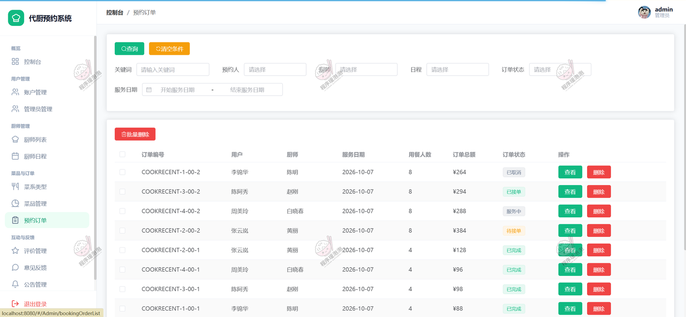

**意见反馈**
按用户、反馈状态、回复时间范围筛选。表格列：名称、反馈内容、反馈图片、回复内容、回复时间、反馈状态、操作。已回复的只留「删除」，待处理的给「处理」。

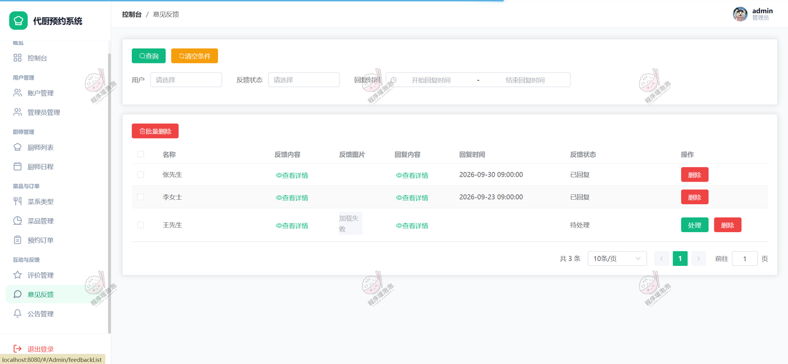

